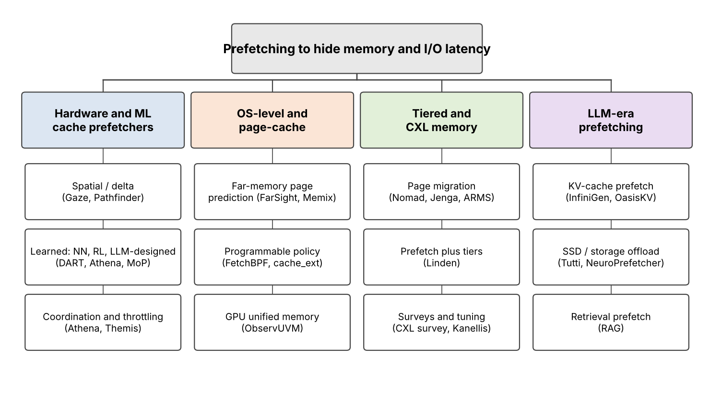
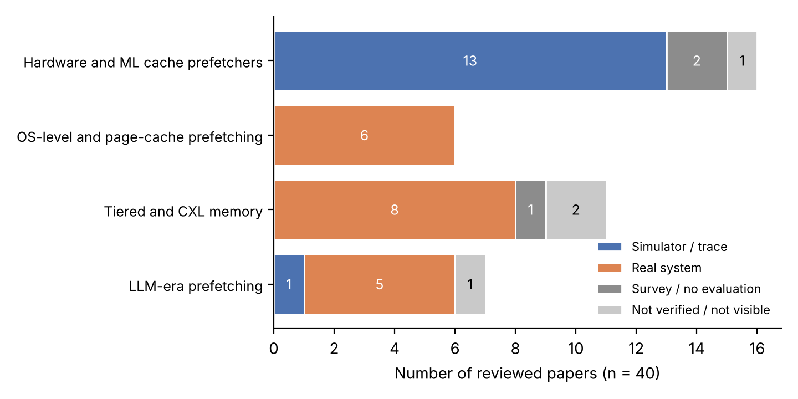
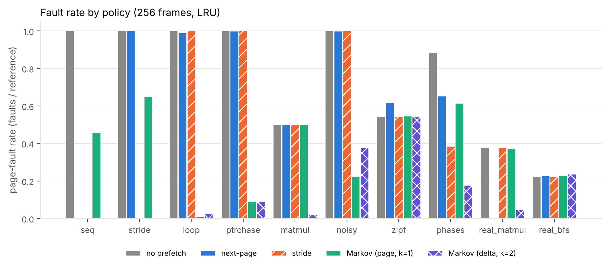
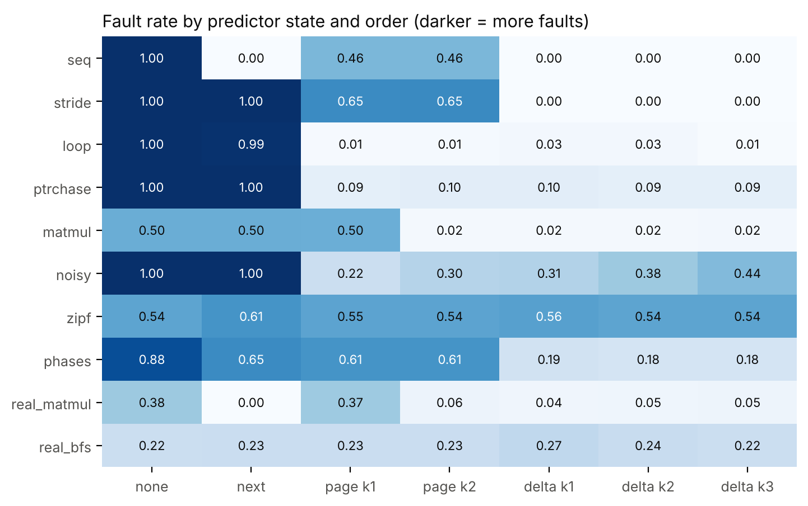
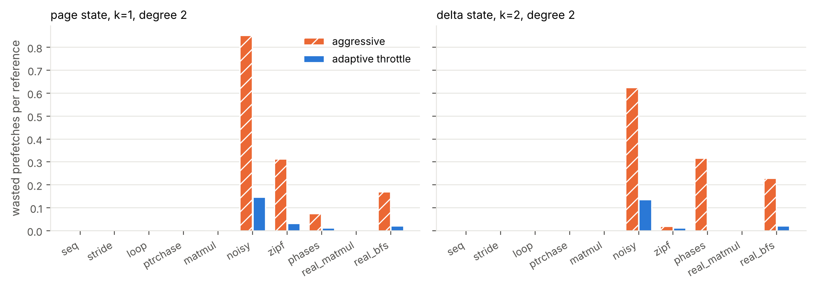
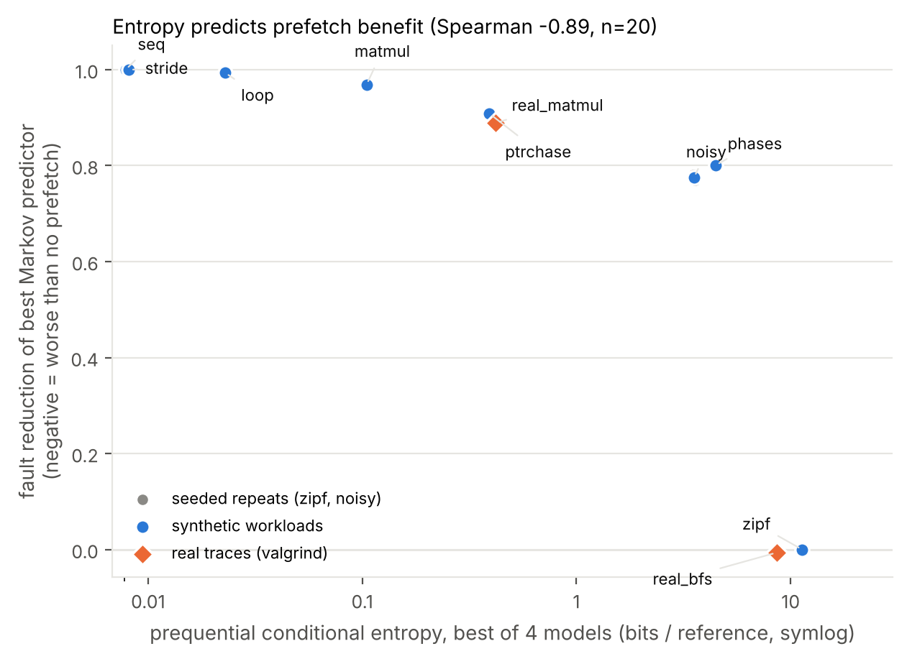

# Prefetching Under Uncertainty: A Review of Recent Memory and Page Prefetching Research and an Entropy-Based Case Study

**Authors:** Pala Gaurav Reddy (PES1UG25AM254) and Punith VC (PES1UG25AM295)

PES University, Bengaluru

UE25CS242A Operating Systems, Mini Project, Topic P11 (Intelligent Memory Prefetching)

```{=openxml}
<w:p><w:r><w:br w:type="page"/></w:r></w:p>
```

## Abstract

Prefetching tries to hide the latency of memory and storage by fetching data before it is requested, but a wrong guess costs bandwidth and can evict useful data. This paper reviews 40 papers from 2024 to 2026 on prefetching and closely related page-placement work, grouped into hardware and machine-learning cache prefetchers, operating-system and page-cache prefetching, tiered and CXL memory management, and prefetching for large language model (LLM) inference. For each paper we record the technique, the evaluation platform, the result reported by its authors and the disadvantage the authors state. The comparison shows that learned cache prefetchers are almost always evaluated in simulators, that OS-level learned prefetchers need per-application training and are tested on few applications, that harm from over-aggressive prefetching recurs across all four groups, and that no common measure of how prefetchable a workload is has been adopted. To probe the last two gaps at small scale we built a trace-driven demand-paging simulator in C and compared no prefetching, next-page, stride and Markov predictors on 20 traces. The benefit of Markov prefetching tracks the conditional entropy of the trace (Spearman -0.89), naive prefetching raises the zipf fault rate from 0.542 to 0.615, and a simple accuracy-driven throttle removes most wasted prefetches. The case study is simulation only, uses two real traces, and does not establish results for real systems.

**Keywords:** prefetching, demand paging, Markov predictor, conditional entropy, tiered memory, far memory, operating systems

## 1. Introduction

A page fault costs orders of magnitude more than a memory access, so a prefetcher that turns faults into hits is valuable. The same idea appears at every level of the memory hierarchy. Hardware prefetchers fetch cache lines [8, 9], operating systems prefetch pages from swap or remote memory [24, 26], tiered-memory systems decide which pages belong in fast memory [30, 33], and LLM serving systems prefetch key-value (KV) cache blocks from CPU memory or SSD [41, 44]. In every case a wrong prediction is not free: it uses bandwidth, and it can displace a page that would have been used.

Recent work has moved quickly toward learned predictors, including neural networks, reinforcement learning and even LLM-designed prefetchers [10, 11, 15]. Yet it is not obvious from the papers themselves how their claims compare, because they use different platforms, workloads and baselines. This paper therefore asks three questions.

- **RQ1.** What techniques have recent (2024 to 2026) papers proposed, and on what platforms were they evaluated?
- **RQ2.** What disadvantages do the authors themselves report, and which recur?
- **RQ3.** Can a small, reproducible experiment shed light on the recurring problems of predictability and harmful prefetching?

Our contributions are: (1) a structured review of 40 recent papers with a comparative table (Table 1), a taxonomy (Figure 1) and an evidence summary (Figure 2); (2) a list of provisional research gaps drawn from that comparison; and (3) an implementation, a C simulator with a workload suite, entropy analysis and an adaptive throttle, that addresses two of those gaps in simulation. We do not claim Markov prefetching is new; it goes back to the 1990s [1, 2].

## 2. Background

**Demand paging and prefetching.** In demand paging a page is loaded only when a process touches it, so the process stalls on every fault. A prefetcher predicts future pages and loads them early. A prefetched page that is referenced before eviction is a *useful* prefetch; one evicted unreferenced is *useless*. Useful prefetches reduce faults, while useless ones waste I/O and can raise the fault rate by displacing resident pages. Metrics used in the literature include accuracy (useful over issued), coverage (faults removed over faults without prefetching) and timeliness (whether the page arrives before it is needed).

**Classical predictors.** Stride prefetching detects a constant difference between successive addresses [4]. Global-history-buffer designs keep a shared history of misses and serve several correlation patterns from one structure [5]. Markov prefetching keeps a table that maps the recent history to the addresses that tended to follow it, and issues several predictions at once [1]. Kroeger and Long applied a multi-order context model from data compression to file accesses [3], and Vitter and Krishnan showed that a compression-based predictor is asymptotically optimal and that its fault rate is governed by the entropy of the access sequence [2]. That last result is the theoretical link between how predictable a workload is and how much a predictor can help, and we return to it in Section 7.

**Learned and OS-level prefetching.** Hashemi et al. connected prefetching to n-gram language models and used recurrent networks as the predictor [6]. Leap brought a lightweight majority-trend detector into the Linux data path for remote memory [7]. The papers reviewed here build on these ideas with newer models and deployments.

**Tiered memory.** With CXL and persistent memory, a machine can have several memory tiers of different speed. Systems place hot pages in the fast tier and migrate pages between tiers, which is closely related to prefetching because both depend on predicting future accesses and both pay for wrong predictions [30, 27, 39].

## 3. Review Methodology

**Review type.** This is a targeted narrative review, not a systematic literature review. We did not follow a PRISMA protocol, and we did not keep a log of every record screened and rejected, so we cannot report screened-and-excluded counts.

**Sources and queries.** We searched the web and arXiv listings and then opened the page of each candidate (arXiv abstract page, USENIX, ACM or the authors' site). Queries combined terms such as *prefetching*, *page prefetching*, *far memory*, *tiered memory CXL*, *learned prefetcher*, *reinforcement learning prefetcher*, *KV cache prefetching* and *readahead eBPF*. We also followed the course reference list for topic P11 and the citations of the surveys we found [23, 39].

**Inclusion and exclusion.** We included papers from 2024 to 2026 that (a) predict or schedule future memory, page, file or KV-cache accesses to hide latency, or (b) manage page placement across memory tiers, which shares the prediction problem. We excluded pre-2024 work from the review set and used it only as background (seven classic papers, Section 2). Of the 40 included papers, 9 are from 2024, 17 from 2025 and 14 from 2026.

**Data extraction.** For each paper we recorded the technique, the evaluation platform (simulator, real system, survey, none), the headline result as the authors state it, and the disadvantage the authors state. Where the text we could read did not give a field we wrote "not stated" or "not read". Numbers are the authors' own and come from different setups, so we do not compare them across papers.

**Verification status.** For 35 papers we read the abstract page or the paper itself. For 5 papers we saw only the title and venue in an index or search result and did not read the technique, so they are marked partial in Table 1 and the spreadsheet that accompanies this paper, and no claim is built on them. Several preprints have not been peer reviewed, and we mark that in the reference list.

**Threats to validity.** The search was not exhaustive and used a general web search engine, so relevant papers may be missing. Venue and year for a few preprints are unconfirmed. We read abstract-level and introduction-level information for most papers, not every experiment.

{width=62%}

*Figure 1. Taxonomy of the reviewed work: four groups with representative papers in each.*

## 4. Literature Review

### 4.1 Hardware and machine-learning cache prefetchers

Hardware work dominates the recent literature. Gaze characterises 4 KB regions by the temporal order of the first two accesses and reports a 27.7% average single-core speedup over no prefetching with 4.46 KB of storage, but it must wait for a second access, which hurts timeliness, and it loses up to 6.9% on some irregular traces [8]. Pathfinder begins from the long list of hand-designed approaches (stride detection, address correlation, delta patterns, irregular-pattern detectors) and asks whether a neural design can learn delta patterns while the program runs and still be implementable in hardware. Its answer is a spiking neural network that learns online; it reports small gains over SPP and Pythia, but it cannot predict first touches of cold pages and still trails Voyager on some benchmarks [9]. DART distils an attention model into lookup tables, cutting inference cost by orders of magnitude while keeping most of the accuracy [10]. Two further papers on neural and graph-based prefetching, one at ISCA 2024 and one in ACM TACO, were only partially verified and are listed for completeness [20, 21]; a conceptual graph-network toolchain reports no experiments [22].

A second theme is coordination and control. Athena uses a reinforcement-learning agent to decide when a prefetcher and an off-chip predictor should act, using accuracy and bandwidth as inputs, and beats earlier coordination policies by 5.0% to 7.9%, but its parameters were tuned only for single-core runs [11]. CRL-Pythia is motivated by multicore machines, where cores prefetch independently and as many as 20% of prefetch requests can be duplicates that only add memory-bus traffic. Its authors name three weaknesses of traditional prefetchers: they use few features, they ignore system-level state, and their policies are rigid. Their fix is a learning table shared across cores, yet their own text reports 40% more over-prediction than Pythia and notes that a shared table can mix conflicting behaviour [12]. Themis uses per-page hints so that the hardware prefetcher is switched off for pages where it is mostly useless, removing about 40.6% of useless prefetches, at the price of a profiling step [13]. A headroom study finds that the best single static policy loses 1.54% to an oracle that switches policy per phase, which points to phase-aware adaptation as an open direction [17]. Bera et al. summarise Pythia, an off-chip load predictor and an RL data-placement policy, and note that combining the predictors naively under-delivers [14].

The newest hardware papers use LLMs to design prefetchers. One work lets agents diagnose the program counters a deployed prefetcher misses and synthesises 17 sub-prefetchers, reporting a 61.1% geometric-mean speedup over no prefetching in simulation [15]; another evolves multi-level prefetchers for the Data Prefetching Championship and gains 0.3% over the previous champion, with weaker multi-core results [16]. Both are simulator studies. A final group applies learned prediction to specific settings: a temporal CNN to limit cache pollution in LLM inference, evaluated only on simulated traces and with figures in the abstract and table that disagree [18], and a streaming decision tree that predicts the next file-offset class on storage traces with high reported accuracy but without a described latency method [19]. A survey of 118 papers on irregular-access prefetching organises this area and lists missing standard benchmarks, energy trade-offs and the absence of a theory of prefetchability as open challenges [23].

### 4.2 Operating-system and page-cache prefetching

Operating-system work is closer to the setting of this course. FarSight starts from a simple problem: datacenters increasingly keep rarely used data in cheaper, more energy-efficient far memory, and applications then stall on fetching it back on demand. Its key observation is that memory accesses are shaped by two different things, application semantics and runtime context, so each can be handled on its own. It places a small offline-trained neural model in the Linux far-memory swap path, predicts ordinals instead of raw addresses and resolves them with per-page future maps, and reports speedups of up to 3.6 times over FastSwap and 2.6 times over Hermit [24]. Its authors note that each application needs its own offline training and that precision is lower than FastSwap at small local memory because it prefetches aggressively. The earlier exploration of the same idea, Memix, frames itself as an attempt to use modern machine learning on a performance-critical problem inside a complex runtime system. It was evaluated on three applications, and its authors are candid about a cost that matters to our own study: aggressive prefetching raises swap-out activity, because every prefetch needs an empty page frame, and even a perfect prefetcher can lose performance when it evicts pages that were still useful. They also say that hash-like patterns suit the approach poorly [25].

A different direction makes policy programmable. FetchBPF is motivated by a practical cost: a prefetch policy tailored to one application's page-access pattern can help, but building and maintaining a custom kernel for that is rarely realistic. It extends eBPF so users can deploy new prefetch policies without a dedicated kernel, with negligible overhead against a native implementation, although its abstract gives no speedups [26]. cache_ext applies the same mechanism to page-cache eviction and reports large throughput gains for custom policies [28]. Linden starts from the observation that current tiering systems hide asymmetric latency by migrating pages, but overlook cases where the latency could simply be tolerated. It argues that on CXL memory prefetching must be tier-aware: hardware prefetching gives a 1.26 times speedup but degrades CXL performance by 19%, and the best prefetch distance differs between tiers [27]. ObservUVM gives the unified-memory driver visibility into the GPU's accesses to its high-bandwidth memory, without hardware changes, so that eviction and prefetching can be better informed. Because policy is kept separate from mechanism, custom policies are simple to write and what-if scenarios are quick to explore. It reuses GPU access counters for this and reports a 34% geometric-mean speedup on one GPU [29].

### 4.3 Tiered and CXL memory management

Tiering papers ask which pages should live in fast memory, a prediction problem with the same cost of error as prefetching. Page migration is the standard way operating systems manage tiered memory, and Nomad asks a more basic question than most papers: is exclusive tiering, where a page is in fast or slow memory but never both, actually the best strategy? It proposes non-exclusive tiering, using shadow copies and transactional migration to avoid stalls, and reports up to 6 times better performance than TPP under thrashing, but multi-mapped pages fall back to synchronous migration [30]. Zhong et al. begin from the cloud providers' wish to add CXL memory for more capacity, lower cost and lower carbon emissions, despite CXL's higher latency than local DRAM. They combine hardware flat-mode tiering with a software layer that uses a random-forest model, which gives performance similar to local DRAM across a wide range of workloads and allows 1.5 times more server memory with minimal impact; it cuts worst-case VM slowdown from about 35% to under 6% [31]. Jenga names two reasons earlier tiering systems perform poorly: hot and cold objects get allocated in the same page, and abrupt changes in measured hotness cause thrashing. It groups objects of similar hotness and decays hotness smoothly, and runs about 28% faster than the best prior system in its main configuration but 5% to 7% slower on workloads with abrupt hot-set changes [33]. ARMS argues that HeMem, Memtis and TPP rely on rigid, pre-set thresholds, which makes them brittle, and traces three symptoms to wrong parameters: inaccurate hot-page identification, slow reaction to hot-set changes and wasteful migrations. It ranks pages by relative score instead of fixed thresholds [34], and Kanellis et al. show that tuning parameters with Bayesian optimisation doubles the performance of existing systems [35]. Cho et al. observe that a tiered system is only as good as the share of accesses its fast tier absorbs, and that every workload has its own migration-friendliness depending on its access pattern and system setup. They propose per-page ping-pong, where pages are repeatedly promoted and demoted, as a metric for whether migration is paying off, and add ping-pong detection to TPP for multi-tenant machines [36]. At the buffer-pool and object level, Rayhan and Aref build an n-tier buffer pool on OS page tables [37], and HADES groups hot and cold objects so that page reclaim works better [38]. A broad CXL survey notes that tiering addresses latency but not bandwidth [39]. Liu et al. present approaches to tiered memory management that go beyond traditional hotness-based policies, but we have so far read only their abstract and cannot yet describe the method [32]. One further tiering paper was only partially verified [40].

### 4.4 Prefetching for LLM inference

LLM inference has created a new prefetching problem, because the KV cache and model weights often exceed GPU memory. InfiniGen predicts which KV entries the next layer needs and prefetches them from CPU memory, reporting up to 3.00 times speedup over earlier KV-cache methods while being 1.52 times slower than an ideal all-on-GPU run [41]. CLO reports 9.3% to 66.6% higher decoding throughput through head-wise caching and prefetching [42]. Tutti moves KV storage to NVMe with a slack-aware scheduler [43], OasisKV uses draft tokens from speculative decoding to predict blocks to prefetch [44], and NeuroPrefetcher predicts which sparse MLP rows to fetch from NVMe, with I/O still 80% to 87% of per-token latency [46]. A prefetching scheme for retrieval-augmented generation predicts retrieval needs from hidden states [47]. One simulator study is notable for a negative result: across its grid of placement policies, prefetching never beat no prefetching, even with an oracle that reads the future [45].

## 5. Comparative Analysis

Table 1 lists all 40 reviewed papers with the platform, the result as stated by the authors and the disadvantage as stated by the authors. Because setups differ, the results are not comparable across rows; the table supports comparison of kinds of evidence and kinds of disadvantage.

**Table 1.** Comparison of the reviewed papers (2024 to 2026). "Not read" means we did not read that item; P marks partially verified entries.

| Ref | Year | Platform | Result as stated by authors | Disadvantage as stated by authors |
|---|----|-----|------------------|------------------|
| [8] | 2025 | Simulator | +27.7% single-core speedup over no prefetching; 4.46 KB storage | Waits for a second access (timeliness); up to 6.9% loss on some irregular traces |
| [9] | 2024 | Simulator | +9.3% IPC over SPP, +2% over Pythia (11 traces) | Trails Voyager on some benchmarks; cannot predict first touch of cold pages |
| [10] | 2024 | Simulator | +37.6% IPC; 170x faster inference than the teacher | Ideal NN prefetchers still beat it; small F1 loss from distillation |
| [11] | 2026 | Simulator | +5.0 to 7.9% over earlier coordination policies; about 3 KB per core | Tuned on single-core only; without an off-chip predictor it mainly avoids loss |
| [12] | 2025 | Simulator | Abstract claims about +12% IPC on bandwidth-limited workloads | Own text reports 40% more overprediction than Pythia; shared table mixes conflicting behaviour |
| [13] | 2026 | Simulator | IPC gains for all seven prefetchers; about 40.6% fewer useless prefetches | Bandwidth results use one trace per workload; needs profiling |
| [14] | 2026 | Simulator and real | Pythia +3.4% over MLOP; Sibyl +28.1% over CDE on hybrid storage | Naive Hermes+Pythia combination under-delivers; Sibyl does not migrate data |
| [15] | 2026 | Simulator | 61.1% geomean IPC speedup; beats Alecto, Berti, Pythia | Simulation only; about 110 KB state; diminishing returns per token spent |
| [16] | 2026 | Simulator | +3.8% geomean IPC over baseline; +0.3% over prior champion | Weaker in multi-core; many candidates fail; limited novelty of designs |
| [17] | 2026 | Simulator | Best static policy loses 1.54% to an oracle; two-policy switching loses 0.11% | Runtime selector and switching cost left as future work |
| [18] | 2025 | Simulator | 89.6% hit rate vs 82.3% for a DNN baseline | Simulated traces only; abstract and table figures disagree |
| [19] | 2025 | Trace replay | 0.976 average accuracy; 0.3 MB memory | Not validated at distributed scale; latency gains reported without method |
| [20] (P) | 2024 | Not verified | Not read | Not read |
| [21] (P) | 2025 | Not verified | Not read | Not read |
| [22] | 2025 | No evaluation | No empirical results | No evaluation; claims are conceptual |
| [23] | 2026 | Survey | Taxonomy; accuracy-overhead Pareto view of ML prefetchers | Cache-centric; lists missing benchmarks and no theory of prefetchability |
| [24] | 2025 | Real system | Up to 3.6x over FastSwap and 2.6x over Hermit | Needs per-application training; lower precision than FastSwap at small local memory |
| [25] | 2025 | Real system | Up to 42% better than FastSwap and Hermit; about 1 microsecond inference | Preliminary; three applications; hash-like patterns poorly suited; aggressive prefetch raises swap-outs |
| [26] | 2024 | Real system | Negligible overhead against native kernel code (abstract gives no numbers) | Abstract reports no speedups; policies come from prior literature |
| [27] | 2025 | Real system | HW prefetching gives 1.26x on CXL but degrades CXL performance by 19% | Proposal; compiler and runtime not fully built |
| [28] (P) | 2025 | Real system | Up to 70% higher throughput and 58% lower tail latency | Eviction, not prefetching; other limits not read |
| [29] | 2026 | Real system | 34% geomean speedup over default UVM | Single-GPU; sampling depends on spatial locality |
| [30] | 2024 | Real system | Up to 6x over TPP under thrashing | Multi-mapped pages fall back to sync migration; Memtis sometimes wins under severe thrashing |
| [31] | 2024 | Real system | Worst-case VM slowdown cut from about 35% to under 6% | Outlier VMs still degrade; no per-core miss counters |
| [32] (P) | 2025 | Not verified | Not read | Not read |
| [33] | 2025 | Real system | About 28% faster than next best when the fast tier fits the working set | 5-7% slower on some workloads; no real CXL hardware |
| [34] | 2025 | Not verified | 1.22 to 1.85x better than untuned prior systems | Evaluation setup not visible in text read |
| [35] | 2025 | Not verified | 2x over default configuration | Setup and limits not visible in text read |
| [36] | 2025 | Real system | Up to 72.0% better than Nomad in multi-tenant runs | MEMTIS excluded from multi-tenant runs; abstract and conclusion averages disagree; code not public |
| [37] | 2026 | Real system | Up to 3.82x on TPC-C; 1.36x on random reads | Migration is the bottleneck; DAX/App Direct memory unsupported |
| [38] | 2025 | Real system | Up to 70% memory reduction at about 3% overhead | Needs annotations; breaks pointer stability and pointer arithmetic |
| [39] | 2024 | Survey | Taxonomy and future directions | Notes tiering addresses latency not bandwidth; no quantitative cost model |
| [40] (P) | 2024 | Not verified | Not read | Not read |
| [41] | 2024 | Real system | Up to 3.00x over prior KV-cache methods | Extra GPU memory; 1.52x slower than an ideal all-on-GPU run |
| [42] | 2025 | Not verified | 9.3 to 66.6% decoding throughput gain | Hardware and benchmark details not visible in text read |
| [43] | 2026 | Real system | 78.3% lower time-to-first-token than LMCache-GDS in one setting | Single two-GPU server; remote retrieval path not optimised |
| [44] | 2026 | Real system | 1.69x throughput over dense vLLM on reasoning workloads | No limitations section in the text read |
| [45] | 2026 | Simulator | Prefetch never beat no-prefetch across the grid, even with an oracle | Synthetic workloads; batch-one decode |
| [46] | 2026 | Real system | 7.9 to 12.0x llama.cpp throughput when the model exceeds memory | NVMe still 80-87% of token latency; one edge platform |
| [47] | 2026 | Real system | 43.5% lower end-to-end latency on HotpotQA with Llama-3.1-8B | Needs model internals; possible training circularity |


{width=62%}

*Figure 2. How the reviewed papers were evaluated, by group.*

Figure 2 shows that, of the 16 hardware and ML cache-prefetcher papers, 12 use a simulator or trace replay, while every OS-level paper we could classify used a real system. Three patterns stand out in the comparison.

**Different evidence in different layers.** Hardware prefetchers are judged by IPC in cycle-level simulators on SPEC, GAP and CloudSuite style traces, while OS-level and tiering papers report throughput or latency on real machines but with small application sets (three to four applications is common). Neither layer shows how the same predictor behaves across both.

**Learned predictors carry deployment costs.** FarSight and Memix need per-application offline training [24, 25]; Pathfinder and DART trade accuracy for hardware cost [9, 10]; the LLM-designed prefetcher needs about 110 KB of state and a large token budget [15]. A count-based predictor needs none of this training, which motivates our case study, although it is also less powerful.

**Over-aggressive prefetching recurs.** Memix warns that aggressive prefetching evicts useful pages [25], CRL-Pythia reports 40% more over-prediction [12], Linden finds hardware prefetching degrades CXL performance by 19% [27], FarSight has lower precision than FastSwap [24], Themis removes about 40.6% useless prefetches [13], and the KV placement study finds prefetching never beat no prefetching [45]. Throttling and coordination are therefore not minor details.

## 6. Research Gaps

The gaps below come from the comparison above. Each is provisional: our search was not systematic, and a paper we did not find may already address it.

**G1. Learned prefetchers are rarely tested both in simulators and on real systems.** Hardware prefetchers are mostly simulated (Figure 2), and OS-level ones use few applications. Evidence: Table 1 and Figure 2. Confidence: moderate, since it rests on the papers we could classify.

**G2. OS-level learned prefetchers depend on offline, per-application training.** FarSight and Memix both state this limitation [24, 25]. We did not find a comparison of a lightweight online count-based predictor with these heavier models at page granularity. Confidence: low to moderate.

**G3. There is no common measure of how prefetchable a workload is.** The prefetching survey lists the lack of a theory of prefetchability and of standard benchmarks as open challenges [23], while Vitter and Krishnan gave a theoretical link between entropy and fault rate decades ago [2]. We did not find a recent empirical study that measures trace entropy and relates it to the benefit of different predictor types. Confidence: low to moderate.

**G4. Containing the harm of wrong prefetches is treated as an add-on.** Section 5 lists six papers that report some form of harm or over-prediction. Throttles are usually built into one design rather than evaluated on their own. Confidence: moderate.

**G5. LLM-era prefetching is evaluated on single platforms and sometimes shows no benefit.** Several LLM papers use one server or one edge device [43, 46], and the KV placement study reports no benefit from prefetching [45]. Confidence: low, because this area is moving quickly.

Our implementation in Section 7 addresses G3 and G4 at small scale and gives a data point for G2. It does not address G1 or G5.

## 7. Implementation and Case Study

### 7.1 Method

**Simulator.** `sim.c` replays a trace of page numbers against a fixed number of frames (256 unless stated) with LRU replacement. A prefetched page is inserted like a demand page but tagged; it is counted *useful* if referenced before eviction and *useless* if evicted unreferenced. Metrics: fault rate (faults / references), prefetch accuracy (useful / issued), wasted prefetches per reference, and table size.

**Predictors.** *none*; *next-page* (always prefetch p+1); *stride* (prefetch p+d when the last two deltas equal d); and a *Markov* predictor whose state is the last k symbols (k = 1, 2, 3), where a symbol is either the page number (*page state*) or the page delta (*delta state*). A direct-mapped, tagged table (2^16 entries by default) maps each state to four successor counters; the predictor prefetches the top-m successors whose share of the counts exceeds a confidence threshold.

**Adaptive throttle.** Every 2,048 references, the fraction of resident prefetched pages that were used decides the confidence threshold level (0.1, 0.4, 0.7 or 0.95): below 0.3 accuracy it moves up one level, above 0.6 it moves down, and with fewer than 32 prefetch outcomes in the window it relaxes by one level to probe again. The levels and cut-offs were chosen by hand, not tuned.

**Workloads.** Synthetic: *seq* (cyclic scan), *stride* (stride-7 scan), *loop* (600-page loop), *ptrchase* (fixed random cycle of 5,000 pages), *matmul* (naive i-j-k, 1024x1024 doubles), *noisy* (ptrchase with 10% random pages), *zipf* (independent Zipf-distributed references over 20,000 pages), *phases* (four different behaviours in sequence). *zipf* and *noisy* were regenerated with five more seeds. Real: a 384x384 naive matrix multiply (*real_matmul*) and a breadth-first search over a random 100,000-node, 300,000-edge graph (*real_bfs*), compiled with gcc -O2 and traced with `valgrind --tool=lackey --trace-mem=yes`. Data references are converted to 4 KB page numbers, consecutive repeats are collapsed, a 200,000-reference window from the compute phase is kept, and page ids are rank-compressed with gaps clipped to 4,096 pages (this keeps small strides but changes absolute addresses).

**Entropy.** For each trace we compute the prequential (online) conditional entropy in bits per reference of the next symbol given the last k symbols, with add-lambda smoothing backed off to a unigram model, for page and delta symbols at k = 1, 2, and report the minimum of the four. This mirrors how an online predictor learns, including its learning cost.

### 7.2 Results

{width=62%}

*Figure 3. Fault rate by policy and workload.*

**Table 2.** Fault rate by policy (256 frames, LRU, 2^16-entry table). Lowest per row in bold.

| workload | none | next-page | stride | Markov page k=1 | Markov page k=2 | Markov delta k=1 | Markov delta k=2 | Markov delta k=3 |
|---|---|---|---|---|---|---|---|---|
| seq | 1.000 | **0.000** | 0.000 | 0.458 | 0.458 | 0.000 | 0.000 | 0.000 |
| stride | 1.000 | 1.000 | 0.000 | 0.649 | 0.653 | **0.000** | 0.000 | 0.000 |
| loop | 1.000 | 0.990 | 1.000 | 0.010 | 0.013 | 0.026 | 0.026 | **0.006** |
| ptrchase | 1.000 | 0.999 | 1.000 | **0.091** | 0.104 | 0.105 | 0.091 | 0.092 |
| matmul | 0.501 | 0.500 | 0.501 | 0.499 | **0.016** | 0.021 | 0.020 | 0.024 |
| noisy | 1.000 | 0.999 | 1.000 | **0.224** | 0.304 | 0.309 | 0.376 | 0.445 |
| zipf | **0.542** | 0.615 | **0.542** | 0.546 | 0.545 | 0.560 | 0.542 | 0.542 |
| phases | 0.885 | 0.652 | 0.385 | 0.614 | 0.615 | 0.188 | 0.176 | **0.176** |
| real_matmul | 0.376 | **0.003** | 0.376 | 0.373 | 0.057 | 0.042 | 0.046 | 0.050 |
| real_bfs | **0.222** | 0.227 | 0.222 | 0.229 | 0.228 | 0.269 | 0.236 | 0.223 |


**Structured access favours Markov, and the right state matters.** On *seq* and *stride*, delta-state Markov reaches 0.000 faults per reference while page-state is stuck at 0.458 (see 7.2.2). On *matmul*, page-state order 1 fails (0.499) because the same page is followed by different pages as the A and B accesses interleave, while order 2 resolves it (0.016) (Figure 4).

**Where prefetching hurts.** On *zipf* no predictor can beat chance: the Markov variants stay within 0.02 of no-prefetch (0.542 to 0.560), and next-page makes things worse (0.615 versus 0.542) by displacing useful pages with useless ones.

**Real traces.** On *real_matmul*, plain next-page prefetching is best (0.003 versus 0.376 with no prefetching); the delta Markov predictor gets to 0.042 (order 1) and a degree-2 variant does better still, but it does not beat the simple heuristic. On *real_bfs*, a pointer-chasing workload, nothing helps: no prefetching gives 0.222, next-page 0.227, delta Markov 0.236. On real_matmul, the regularity the Markov predictor learns is also captured by next-page, which needs no table.

#### 7.2.1 Frame count

Prefetching gains are largest when the frame count is below the working set; once everything fits, the policies converge (the 600-page *loop* trace (curves for every workload are in `figures/fig2_frames.png` in the repository) stops faulting for every policy once 1,024 frames are available). On *zipf* and *phases* the fault rate keeps falling smoothly as frames grow and the policies stay ordered the same way.

#### 7.2.2 Table size

(Sweep plot: `figures/fig5_tablesize.png` in the repository.) A page-state predictor needs about one entry per distinct page: on *seq* (30,000 pages) its fault rate is 0.458 at 2^16 entries and 0.241 at 2^18, which we attribute to direct-mapped collisions evicting learned successors (we have not isolated this with an associative table). The delta state is insensitive: *seq* stays at 0.000 even at 2^8 entries, since a sequential stream has a single repeating delta.

#### 7.2.3 Order and state

{width=62%}

*Figure 4. Fault rate by Markov order and state type.*

Higher order helps with interleaved streams (matmul) but hurts under noise (noisy: fault rate rises with k for delta states) since longer contexts are seen fewer times.

#### 7.2.4 Adaptive throttle

{width=62%}

*Figure 5. Wasted prefetches per reference, aggressive versus adaptive.*

**Table 3.** Page-state k=1, degree 2: aggressive (threshold 0) versus adaptive throttle.

| workload | aggressive: wasted/ref | adaptive: wasted/ref | aggressive: fault rate | adaptive: fault rate |
|---|----|-----|------------------|------------------|
| seq | 0.000 | 0.000 | 0.458 | 0.458 |
| stride | 0.000 | 0.000 | 0.649 | 0.649 |
| loop | 0.000 | 0.000 | 0.010 | 0.010 |
| ptrchase | 0.000 | 0.000 | 0.091 | 0.091 |
| matmul | 0.004 | 0.004 | 0.498 | 0.498 |
| noisy | 0.852 | 0.147 | 0.223 | 0.223 |
| zipf | 0.314 | 0.032 | 0.548 | 0.543 |
| phases | 0.074 | 0.012 | 0.615 | 0.613 |
| real_matmul | 0.000 | 0.000 | 0.372 | 0.372 |
| real_bfs | 0.170 | 0.021 | 0.235 | 0.225 |


On *zipf* the throttle cuts wasted prefetches per reference from 0.314 to 0.032, and on *noisy* from 0.852 to 0.147, with essentially unchanged fault rates. On *real_bfs* with the delta predictor it brings the fault rate from 0.242 (aggressive) to 0.225, close to no-prefetch (0.222).

#### 7.2.5 Entropy and benefit

{width=62%}

*Figure 6. Trace entropy against the fault reduction from the best Markov configuration.*

**Table 4.** Entropy of each workload and the best Markov configuration's gain over no prefetching.

| workload | best model entropy (bits/ref) | best Markov config | fault rate: none | fault rate: best Markov | reduction |
|---|---|----|-----|------------------|------------------|
| seq | 0.001 | mk-delta-k1 | 1.000 | 0.000 | 1.000 |
| stride | 0.002 | mk-delta-k1 | 1.000 | 0.000 | 1.000 |
| loop | 0.042 | mk-delta-k3 | 1.000 | 0.006 | 0.994 |
| ptrchase | 0.391 | mk-page-k1 | 1.000 | 0.091 | 0.909 |
| matmul | 0.105 | mk-page-k2 | 0.501 | 0.016 | 0.969 |
| noisy | 3.543 | mk-page-k1 | 1.000 | 0.224 | 0.776 |
| zipf | 11.323 | mk-delta-k3 | 0.542 | 0.542 | -0.000 |
| phases | 4.469 | mk-delta-k3 | 0.885 | 0.176 | 0.801 |
| real_matmul | 0.420 | mk-delta-k1 | 0.376 | 0.042 | 0.889 |
| real_bfs | 8.603 | mk-delta-k3 | 0.222 | 0.223 | -0.007 |


Across all 20 traces the rank correlation between entropy and fault reduction is -0.89 (and -0.98 over the ten distinct workloads): low-entropy streams (seq, stride, loop, matmul) are almost fully fixed, mid-entropy streams (noisy, phases) are partly fixed, and the high-entropy streams (zipf, real_bfs) are not fixed at all. Seed-to-seed variation of the fault rate is small (standard deviation 0.0000 for noisy, 0.0016 for zipf with no prefetch).


## 8. Discussion and limitations

- **Simulator, not system.** There is no timing model, no I/O latency or bandwidth, no multiprocess interference, and prefetches are free and instantaneous. Fault counts are a proxy for performance. Real prefetching also competes for disk bandwidth, which would make the harm on high-entropy traces worse.
- **Traces.** All eight synthetic workloads are our own constructions, designed to span predictable and unpredictable behaviour; they show *mechanism*, not typical programs. The real evidence is two programs, 200,000 page references each, with a rank-compression step that alters absolute addresses. More real programs are needed before general claims.
- **Entropy and benefit are not independent measurements.** Both come from count-based predictions over the same stream, so a strong correlation is partly expected (Vitter and Krishnan make the connection formal). The contribution here is the empirical demonstration across predictors, workloads and real traces, not the existence of the relationship. The effective sample is ten distinct workloads, not twenty traces.
- **Throttle.** Its levels and cut-offs are hand-chosen and not tuned or validated on held-out workloads.
- **Predictor.** Direct-mapped table, four successors per entry, count-based confidence; no aging of old counts, which may hurt on phase changes.


## 9. Conclusion

Recent prefetching research is rich but uneven. Hardware prefetchers are mostly simulated, OS-level learned prefetchers need training and are tested on few applications, tiering work shares the same prediction problem, and LLM-serving systems are adopting prefetching quickly. Across all of them, the cost of wrong predictions keeps reappearing, and no common measure of prefetchability is in use. Our case study shows, in simulation, that the benefit of a Markov prefetcher follows the entropy of the reference stream, that naive prefetching hurts high-entropy workloads, and that a simple accuracy throttle removes most wasted prefetches. On the two real traces we tested, the simplest heuristic (next-page) was as good as or better than the Markov predictor where prefetching helped at all, so the practical case for added complexity is not established by this evidence.

### 9.1 Future work

1. Add a timing model so that fault counts become time, then run in a real kernel and compare with trend-based prefetching [7] and learned OS prefetchers [24].
2. Collect many more real traces and test the entropy-benefit relationship on held-out workloads.
3. Tune the throttle on held-out traces and compare with learned coordination [11].
4. Replace this targeted review with a systematic one that has a stated protocol and a screening log, to confirm or reject G1 to G5.

## Reproducibility

`make all` rebuilds the simulator, regenerates traces, runs every experiment (all random seeds fixed) and regenerates all figures and the tables in this paper. Source: `sim.c`, `gen_traces.py`, `run_experiments.py`, `analyze.py`, `make_paper.py`.

## References

[1] D. Joseph and D. Grunwald, "Prefetching using Markov predictors," Proc. 24th Int. Symp. on Computer Architecture (ISCA), 1997.

[2] J. S. Vitter and P. Krishnan, "Optimal prefetching via data compression," Journal of the ACM, vol. 43, no. 5, pp. 771-793, 1996.

[3] T. M. Kroeger and D. D. E. Long, "Predicting future file-system actions from prior events," Proc. USENIX Annual Technical Conference, 1996.

[4] T.-F. Chen and J.-L. Baer, "Effective hardware-based data prefetching for high-performance processors," IEEE Trans. Computers, vol. 44, no. 5, pp. 609-623, doi:10.1109/12.381947, 1995.

[5] K. J. Nesbit and J. E. Smith, "Data cache prefetching using a global history buffer," Proc. 10th Int. Symp. on High-Performance Computer Architecture (HPCA), pp. 96-105, doi:10.1109/HPCA.2004.10030, 2004.

[6] M. Hashemi, K. Swersky, J. A. Smith, G. Ayers, H. Litz, J. Chang, C. Kozyrakis and P. Ranganathan, "Learning memory access patterns," Proc. 35th Int. Conf. on Machine Learning (ICML), PMLR vol. 80, pp. 1919-1928, 2018.

[7] H. Al Maruf and M. Chowdhury, "Effectively prefetching remote memory with Leap," Proc. USENIX Annual Technical Conference (ATC), pp. 843-857, 2020.

[8] Z. Chen, C. Wu, Y. Gu, R. Jia, J. Li and M. Guo, "Gaze into the pattern: characterizing spatial patterns with internal temporal correlations for hardware prefetching," Proc. IEEE HPCA (arXiv:2412.05211), 2025.

[9] L. Jia, J. P. McMahon, S. Gudaparthi, S. Singh and R. Balasubramonian, "Pathfinder: practical real-time learning for data prefetching," Proc. ASPLOS, 2024.

[10] P. Zhang, N. Gupta, R. Kannan and V. K. Prasanna, "Attention, distillation, and tabularization: towards practical neural network-based prefetching," arXiv:2401.06362, 2024.

[11] R. Bera, Z. Lang, C. Hengartner, K. Kanellopoulos, R. Kumar, M. Sadrosadati and O. Mutlu, "Athena: synergizing data prefetching and off-chip prediction via online reinforcement learning," arXiv:2601.17615, 2026.

[12] M. H. Siddiqui, Y. Wu, F. Guzman and R. Ann, "Coordinated reinforcement learning prefetching architecture for multicore systems," arXiv:2509.10719, 2025.

[13] K. Kamahori et al., "Themis: software-defined hardware prefetching," arXiv:2608.00259, 2026.

[14] R. Bera, R. Nadig and O. Mutlu, "Machine learning-driven intelligent memory system design: from on-chip caches to storage," IEEE Micro (extended version arXiv:2603.14583), 2026.

[15] X. Sun, C. Xu, N. Ai, Z. Zhu, Y. Yuan and Y. Xie, "Why do prefetchers fail? Let agents answer," arXiv:2608.13027, 2026.

[16] A. Gonzalez, R. Gupta, A. Jain et al., "ArchAgent v2: a case study with the Data Prefetching Championship," arXiv:2608.09874, 2026.

[17] Y. Zhang, I. McDougall, J. Li, S. Wadle, V. Singh and K. Sankaralingam, "Beyond static policies: exploring dynamic policy selection for single-thread performance optimization," arXiv:2605.05471, 2026.

[18] S. Liu, H. Du and S. Wang, "Adaptive cache pollution control for large language model inference workloads using temporal CNN-based prediction and priority-aware replacement," arXiv:2512.14151, 2025.

[19] C. Cheng, C. Zhou, Y. Zhao and J. Cao, "Dynamic adaptation in data storage: real-time machine learning for enhanced prefetching," arXiv:2501.14771, 2025.

[20] Q. Duong et al., "A new formulation of neural data prefetching," Proc. ISCA (authors beyond first not checked), 2024. (partially verified: title and venue only)

[21] Jiang et al., "TRACED: a temporal graph neural networks-based model for data prefetching," ACM Trans. Architecture and Code Optimization (TACO), 2025. (partially verified: title and venue only)

[22] F. I. Qowy, "Prefetching cache optimization using graph neural networks: a modular framework and conceptual analysis," arXiv:2510.21865, 2025.

[23] S. S. Manohar et al., "Toward intelligent prefetching: a survey on complex memory access prediction techniques," arXiv:2606.09955 (venue and full author list unconfirmed), 2026.

[24] Y. Huang, Z. Guo and Y. Zhang, "Learning semantics, not addresses: runtime neural prefetching for far memory (FarSight)," arXiv:2506.00384, 2025.

[25] Y. Huang, Z. Guo and Y. Zhang, "An early exploration of deep-learning-driven prefetching for far memory," arXiv:2510.04360, 2025.

[26] X. Cao, S. Patel, S. Y. Lim, X. Han and T. Pasquier, "FetchBPF: customizable prefetching policies in Linux with eBPF," Proc. USENIX ATC, pp. 369-378, 2024.

[27] M. Unal, V. Gupta, Y. Pan, Y. Ren and S. Kashyap, "Tolerate it if you cannot reduce it: handling latency in tiered memory," HotOS, 2025.

[28] Authors not read, "cache_ext: customizing the page cache with eBPF," Proc. ACM SOSP (pp. 462-478; year and authors from index page not confirmed), 2025. (partially verified: title and venue only)

[29] B. Pratheek, K. Shah and A. Basu, "Observability-aided GPU memory oversubscription," Venue not stated on the page read (artifact name suggests ISCA 2026), 2026.

[30] L. Xiang, Z. Lin, W. Deng, H. Lu, J. Rao, Y. Yuan and R. Wang, "Nomad: non-exclusive memory tiering via transactional page migration," Proc. USENIX OSDI, 2024.

[31] Y. Zhong, D. S. Berger, C. Waldspurger et al., "Managing memory tiers with CXL in virtualized environments," Proc. USENIX OSDI, 2024.

[32] J. Liu, H. Hadian, H. Xu and H. Li, "Tiered memory management beyond hotness," Proc. USENIX OSDI, 2025. (partially verified: title and venue only)

[33] R. Kadekodi, H. Peng, G. Bernstein, M. D. Ernst and B. Kasikci, "Jenga: responsive tiered memory management without thrashing," arXiv:2510.22869, 2025.

[34] S. Yadalam, K. Kanellis, M. Swift and S. Venkataraman, "ARMS: adaptive and robust memory tiering system," arXiv:2508.04417, 2025.

[35] K. Kanellis, S. Yadalam, F. Chen, M. Swift and S. Venkataraman, "From good to great: improving memory tiering performance through parameter tuning," arXiv:2504.18714, 2025.

[36] H. Cho, I. Kim, K. Choi, H. Kim, W. Lee, J. Im, J. So and J. Huh, "Adaptive migration decision for multi-tenant memory systems," arXiv:2505.09164, 2025.

[37] Y. Rayhan and W. G. Aref, "Virtual-memory assisted buffer management in tiered memory," arXiv:2603.03271, 2026.

[38] V. Banakar, S. Yang, K. Wu, A. C. Arpaci-Dusseau, R. H. Arpaci-Dusseau and K. Keeton, "Tidying up the address space," 3rd Workshop on Disruptive Memory Systems (DIMES), 2025.

[39] C. Chen, X. Zhao, G. Cheng, Y. Xu, S. Deng, J. Yin and Y. Xu, "Next-gen computing systems with Compute Express Link: a comprehensive survey," arXiv:2412.20249, 2024.

[40] Authors not read, "NeoMem: hardware/software co-design for CXL-native memory tiering," arXiv:2403.18702 (venue not confirmed), 2024. (partially verified: title and venue only)

[41] W. Lee, J. Lee, J. Seo and J. Sim, "InfiniGen: efficient generative inference of large language models with dynamic KV cache management," arXiv:2406.19707, 2024.

[42] J. Yi, P. Gong, Y. Bai et al., "CLO: efficient LLM inference system with CPU-light KV-cache offloading via algorithm-system co-design," arXiv:2511.14510, 2025.

[43] S. Qiu, Y. Hu, X. Wang et al., "Tutti: making SSD-backed KV cache practical for long-context LLM serving," arXiv:2605.03375, 2026.

[44] C. Xiao, S. Cho, J. We et al., "OasisKV: scaling in-decode KV cache beyond HBM with lookahead sparse prefetching," arXiv:2608.08097, 2026.

[45] S. D. Tumkur, J. Iyer, M. Simhadri et al., "Where should the KV cache live? Placement policies across GPU, CPU, and SSD for long-lived sessions," arXiv:2609.16215, 2026.

[46] Dhar, Islam, Zhang, Sun, Islam, Deng and Suo, "NeuroPrefetcher: storage-aware sparse LLM inference via delta prefetching," Proc. ICPP (arXiv:2608.22643), 2026.

[47] W. Zhang and S. Pei, "Predictive prefetching for retrieval-augmented generation," Proc. ICML (PMLR 306), 2026.

