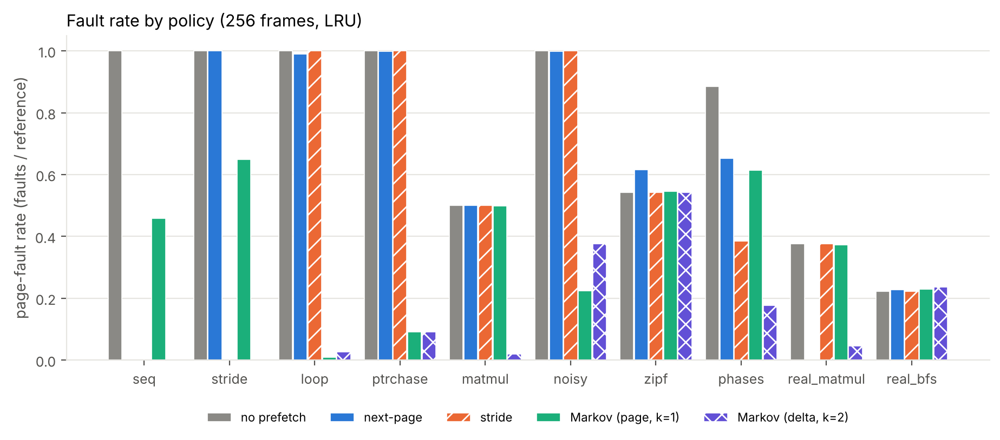
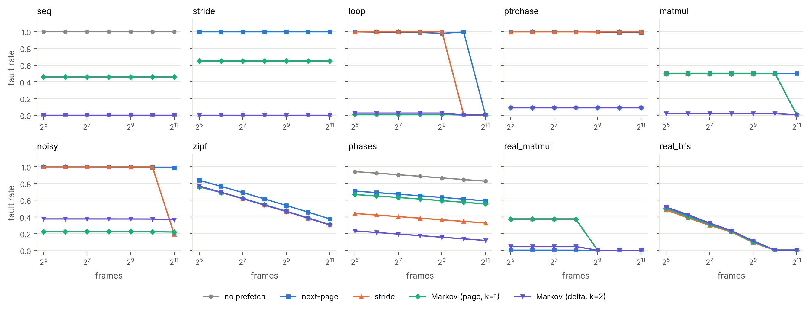
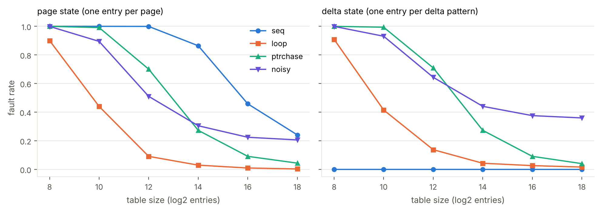
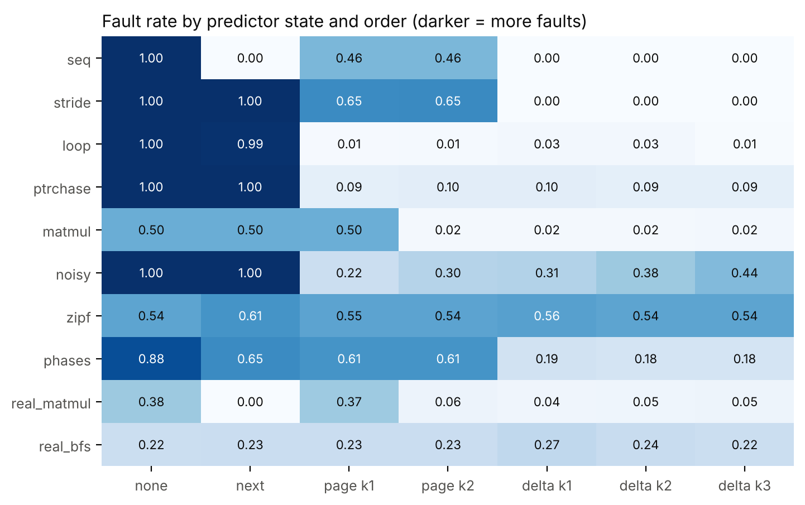
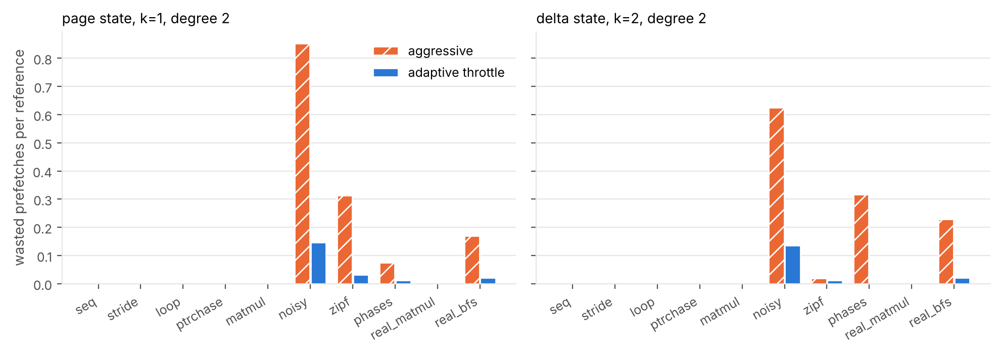
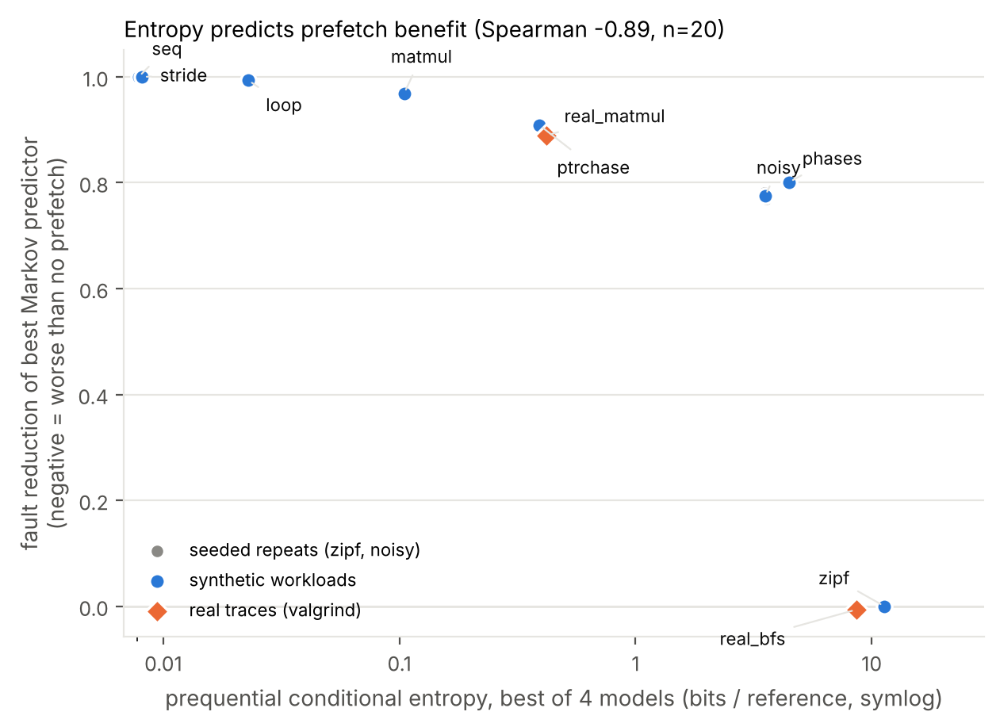

# When Does Markov Prefetching Pay Off? An Entropy-Based Study with an Adaptive Throttle

**Author:** Pala Gaurav Reddy (PES1UG25AM254) · PES University, Bengaluru · UE25CS242A Operating Systems mini project (P11)

## Abstract

Demand paging stalls a process on every page fault, and prefetching tries to hide that cost by loading pages before they are referenced. A Markov predictor learns which page (or page delta) tends to follow the recent history and prefetches the most likely successors. We built a trace-driven demand-paging simulator in C and compared no prefetching, next-page, stride and order-1 to 3 Markov predictors (page-state and delta-state) on 20 traces: eight synthetic workloads, seeded repeats of the two random ones, and two real traces captured with valgrind. We find that (i) the benefit of Markov prefetching tracks the conditional entropy of the trace (Spearman -0.89 over all 20 traces) and vanishes on high-entropy workloads; (ii) naive prefetching is actively harmful there (next-page raises the zipf fault rate from 0.542 to 0.615); (iii) delta states need a tiny table while page states need one entry per page; and (iv) a simple accuracy-driven throttle removes most wasted prefetches at essentially no cost in faults. This is a simulation study: there is no timing model, and the real-trace evidence rests on two programs.

## 1. Introduction

A page fault costs orders of magnitude more than a memory access, so anything that converts faults into prefetch hits is valuable, but a wrong prefetch wastes I/O and evicts a useful page. The question this project asks is not "does Markov prefetching work" (it can) but **when**, and how to stop it from hurting when it does not. Our contributions:

1. A reproducible C simulator and workload suite for comparing prefetchers under LRU replacement.
2. An empirical link between the entropy of a trace's reference stream and the benefit of a Markov predictor.
3. A small adaptive throttle, with an evaluation of what it saves and what it costs.

We do not claim Markov prefetching itself is new; see Section 2.

## 2. Background and related work

*TODO (author): this section must come from your own reading. Starting points to verify and cite properly, none of which I have checked page-by-page:*

- Joseph and Grunwald, "Prefetching using Markov predictors," ISCA 1997: the original Markov prefetcher; our predictor is a simplified, software-level version of the idea.
- Vitter and Krishnan, "Optimal prefetching via data compression," Journal of the ACM, 1996: relates prefetch performance to the entropy of the access sequence. This is the theory behind our entropy analysis, so our result is an empirical illustration of a known relationship, not a new theorem.
- Chen and Baer, hardware stride prefetching (IEEE Trans. Computers, 1995), and Nesbit and Smith, global history buffer prefetching (HPCA 2004).
- The course reference list for P11: Liu et al., OSDI 2025 (tiered memory), Sun et al., ASPLOS 2025 (M5), Chai et al., OSDI 2025 (EMT), He et al., SOSP 2025. These concern page placement and migration in tiered/CXL memory and give context for why workload-aware memory policies matter; they are not prefetching-accuracy studies.

Write a literature matrix (paper, problem, method, metric, gap) and a short paragraph per cluster.

## 3. Method

**Simulator.** `sim.c` replays a trace of page numbers against a fixed number of frames (256 unless stated) with LRU replacement. A prefetched page is inserted like a demand page but tagged; it is counted *useful* if referenced before eviction and *useless* if evicted unreferenced. Metrics: fault rate (faults / references), prefetch accuracy (useful / issued), wasted prefetches per reference, and table size.

**Predictors.** *none*; *next-page* (always prefetch p+1); *stride* (prefetch p+d when the last two deltas equal d); and a *Markov* predictor whose state is the last k symbols (k = 1, 2, 3), where a symbol is either the page number (*page state*) or the page delta (*delta state*). A direct-mapped, tagged table (2^16 entries by default) maps each state to four successor counters; the predictor prefetches the top-m successors whose share of the counts exceeds a confidence threshold.

**Adaptive throttle.** Every 2,048 references, the fraction of resident prefetched pages that were used decides the confidence threshold level (0.1, 0.4, 0.7 or 0.95): below 0.3 accuracy it moves up one level, above 0.6 it moves down, and with fewer than 32 prefetch outcomes in the window it relaxes by one level to probe again. The levels and cut-offs were chosen by hand, not tuned.

**Workloads.** Synthetic: *seq* (cyclic scan), *stride* (stride-7 scan), *loop* (600-page loop), *ptrchase* (fixed random cycle of 5,000 pages), *matmul* (naive i-j-k, 1024x1024 doubles), *noisy* (ptrchase with 10% random pages), *zipf* (independent Zipf-distributed references over 20,000 pages), *phases* (four different behaviours in sequence). *zipf* and *noisy* were regenerated with five more seeds. Real: a 384x384 naive matrix multiply (*real_matmul*) and a breadth-first search over a random 100,000-node, 300,000-edge graph (*real_bfs*), compiled with gcc -O2 and traced with `valgrind --tool=lackey --trace-mem=yes`. Data references are converted to 4 KB page numbers, consecutive repeats are collapsed, a 200,000-reference window from the compute phase is kept, and page ids are rank-compressed with gaps clipped to 4,096 pages (this keeps small strides but changes absolute addresses).

**Entropy.** For each trace we compute the prequential (online) conditional entropy in bits per reference of the next symbol given the last k symbols, with add-lambda smoothing backed off to a unigram model, for page and delta symbols at k = 1, 2, and report the minimum of the four. This mirrors how an online predictor learns, including its learning cost.

## 4. Results

**Table 1.** Fault rate by policy (256 frames, LRU, 2^16-entry table). Lowest per row in bold.

| workload | none | next-page | stride | Markov page k=1 | Markov page k=2 | Markov delta k=1 | Markov delta k=2 | Markov delta k=3 |
|---|---|---|---|---|---|---|---|---|
| seq | 1.000 | **0.000** | 0.000 | 0.458 | 0.458 | 0.000 | 0.000 | 0.000 |
| stride | 1.000 | 1.000 | 0.000 | 0.649 | 0.653 | **0.000** | 0.000 | 0.000 |
| loop | 1.000 | 0.990 | 1.000 | 0.010 | 0.013 | 0.026 | 0.026 | **0.006** |
| ptrchase | 1.000 | 0.999 | 1.000 | **0.091** | 0.104 | 0.105 | 0.091 | 0.092 |
| matmul | 0.501 | 0.500 | 0.501 | 0.499 | **0.016** | 0.021 | 0.020 | 0.024 |
| noisy | 1.000 | 0.999 | 1.000 | **0.224** | 0.304 | 0.309 | 0.376 | 0.445 |
| zipf | **0.542** | 0.615 | **0.542** | 0.546 | 0.545 | 0.560 | 0.542 | 0.542 |
| phases | 0.885 | 0.652 | 0.385 | 0.614 | 0.615 | 0.188 | 0.176 | **0.176** |
| real_matmul | 0.376 | **0.003** | 0.376 | 0.373 | 0.057 | 0.042 | 0.046 | 0.050 |
| real_bfs | **0.222** | 0.227 | 0.222 | 0.229 | 0.228 | 0.269 | 0.236 | 0.223 |

**Structured access favours Markov, and the right state matters.** On *seq* and *stride*, delta-state Markov reaches 0.000 faults per reference while page-state is stuck at 0.458 (see 4.2). On *matmul*, page-state order 1 fails (0.499) because the same page is followed by different pages as the A and B accesses interleave, while order 2 resolves it (0.016) (Figure 4).

**Where prefetching hurts.** On *zipf* no predictor can beat chance: the Markov variants stay within 0.02 of no-prefetch (0.542 to 0.560), and next-page makes things worse (0.615 versus 0.542) by displacing useful pages with useless ones.

**Real traces.** On *real_matmul*, plain next-page prefetching is best (0.003 versus 0.376 with no prefetching); the delta Markov predictor gets to 0.042 (order 1) and a degree-2 variant does better still, but it does not beat the simple heuristic. On *real_bfs*, a pointer-chasing workload, nothing helps: no prefetching gives 0.222, next-page 0.227, delta Markov 0.236. On real_matmul, the regularity the Markov predictor learns is also captured by next-page, which needs no table.

### 4.1 Frame count

Prefetching gains are largest when the frame count is below the working set; once everything fits, the policies converge (the 600-page *loop* trace stops faulting for every policy once 1,024 frames are available). On *zipf* and *phases* the fault rate keeps falling smoothly as frames grow and the policies stay ordered the same way.

### 4.2 Table size

A page-state predictor needs about one entry per distinct page: on *seq* (30,000 pages) its fault rate is 0.458 at 2^16 entries and 0.241 at 2^18, which I attribute to direct-mapped collisions evicting learned successors (I have not isolated this with an associative table). The delta state is insensitive: *seq* stays at 0.000 even at 2^8 entries, since a sequential stream has a single repeating delta.

### 4.3 Order and state

Higher order helps with interleaved streams (matmul) but hurts under noise (noisy: fault rate rises with k for delta states) since longer contexts are seen fewer times.

### 4.4 Adaptive throttle

**Table 2.** Page-state k=1, degree 2: aggressive (threshold 0) versus adaptive throttle.

| workload | aggressive: wasted/ref | adaptive: wasted/ref | aggressive: fault rate | adaptive: fault rate |
|---|---|---|---|---|
| seq | 0.000 | 0.000 | 0.458 | 0.458 |
| stride | 0.000 | 0.000 | 0.649 | 0.649 |
| loop | 0.000 | 0.000 | 0.010 | 0.010 |
| ptrchase | 0.000 | 0.000 | 0.091 | 0.091 |
| matmul | 0.004 | 0.004 | 0.498 | 0.498 |
| noisy | 0.852 | 0.147 | 0.223 | 0.223 |
| zipf | 0.314 | 0.032 | 0.548 | 0.543 |
| phases | 0.074 | 0.012 | 0.615 | 0.613 |
| real_matmul | 0.000 | 0.000 | 0.372 | 0.372 |
| real_bfs | 0.170 | 0.021 | 0.235 | 0.225 |

On *zipf* the throttle cuts wasted prefetches per reference from 0.314 to 0.032, and on *noisy* from 0.852 to 0.147, with essentially unchanged fault rates. On *real_bfs* with the delta predictor it brings the fault rate from 0.242 (aggressive) to 0.225, close to no-prefetch (0.222).

### 4.5 Entropy and benefit

**Table 3.** Entropy of each workload and the best Markov configuration's gain over no prefetching.

| workload | best model entropy (bits/ref) | best Markov config | fault rate: none | fault rate: best Markov | reduction |
|---|---|---|---|---|---|
| seq | 0.001 | mk-delta-k1 | 1.000 | 0.000 | 1.000 |
| stride | 0.002 | mk-delta-k1 | 1.000 | 0.000 | 1.000 |
| loop | 0.042 | mk-delta-k3 | 1.000 | 0.006 | 0.994 |
| ptrchase | 0.391 | mk-page-k1 | 1.000 | 0.091 | 0.909 |
| matmul | 0.105 | mk-page-k2 | 0.501 | 0.016 | 0.969 |
| noisy | 3.543 | mk-page-k1 | 1.000 | 0.224 | 0.776 |
| zipf | 11.323 | mk-delta-k3 | 0.542 | 0.542 | -0.000 |
| phases | 4.469 | mk-delta-k3 | 0.885 | 0.176 | 0.801 |
| real_matmul | 0.420 | mk-delta-k1 | 0.376 | 0.042 | 0.889 |
| real_bfs | 8.603 | mk-delta-k3 | 0.222 | 0.223 | -0.007 |

Across all 20 traces the rank correlation between entropy and fault reduction is -0.89 (and -0.98 over the ten distinct workloads): low-entropy streams (seq, stride, loop, matmul) are almost fully fixed, mid-entropy streams (noisy, phases) are partly fixed, and the high-entropy streams (zipf, real_bfs) are not fixed at all. Seed-to-seed variation of the fault rate is small (standard deviation 0.0000 for noisy, 0.0016 for zipf with no prefetch).

## 5. Discussion and limitations

- **Simulator, not system.** There is no timing model, no I/O latency or bandwidth, no multiprocess interference, and prefetches are free and instantaneous. Fault counts are a proxy for performance. Real prefetching also competes for disk bandwidth, which would make the harm on high-entropy traces worse.
- **Traces.** All eight synthetic workloads are my own constructions, designed to span predictable and unpredictable behaviour; they show *mechanism*, not typical programs. The real evidence is two programs, 200,000 page references each, with a rank-compression step that alters absolute addresses. More real programs are needed before general claims.
- **Entropy and benefit are not independent measurements.** Both come from count-based predictions over the same stream, so a strong correlation is partly expected (Vitter and Krishnan make the connection formal). The contribution here is the empirical demonstration across predictors, workloads and real traces, not the existence of the relationship. The effective sample is ten distinct workloads, not twenty traces.
- **Throttle.** Its levels and cut-offs are hand-chosen and not tuned or validated on held-out workloads.
- **Predictor.** Direct-mapped table, four successors per entry, count-based confidence; no aging of old counts, which may hurt on phase changes.

## 6. Conclusion

A Markov prefetcher is worth deploying when the reference stream has low conditional entropy, and the choice of state (page versus delta) and order matters as much as the algorithm. When entropy is high, simple prefetching hurts and Markov prefetching adds nothing, so an accuracy-based throttle is the safe default. On the two real traces we tested, the simplest heuristic (next-page) was as good as or better than the Markov predictor where any prefetching helped, so the practical case for the added complexity is, on this evidence, not established.

## Reproducibility

`make all` rebuilds the simulator, regenerates traces, runs every experiment (all random seeds fixed) and regenerates all figures and the tables in this paper. Source: `sim.c`, `gen_traces.py`, `run_experiments.py`, `analyze.py`, `make_paper.py`.
